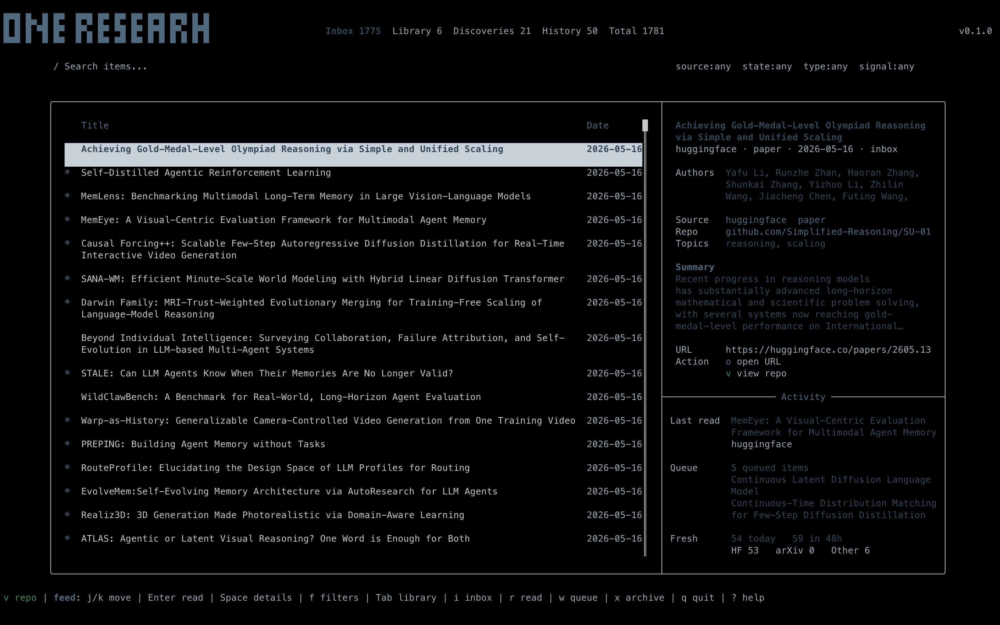

# One-Research

[](https://github.com/VictoryChianumba/one-research/actions/workflows/ci.yml)
[](https://github.com/VictoryChianumba/one-research/actions/workflows/release.yml)
[](https://github.com/VictoryChianumba/one-research/releases)

A terminal UI for following AI research — aggregates arXiv, HuggingFace daily papers, and blog feeds into a single keyboard-driven interface.



## Features

- Aggregates arXiv (cs.LG, cs.AI, stat.ML and more), HuggingFace daily papers, OpenReview, optional CORE, OpenAI blog, DeepMind blog, BAIR blog, MIT News AI, Import AI newsletter, and any custom RSS/Atom feed
- **Subject Browser** — navigate arXiv's full taxonomy (8 groups, ~155 categories) and promote any subject into your daily feed with one keystroke
- Workflow states per item: Inbox, Queued, Deep Read, Archived — persisted across sessions
- Full-text reader: opens papers and articles inline without leaving the TUI
- Split-view reader: primary feed alongside a persistent reader pane, independently scrollable
- Floating reader popup: open a paper in a centered overlay without leaving the feed
- GitHub repository browser: browse and read linked repos from the details panel
- Notes panel: per-session markdown notes alongside any pane
- Chat panel: ask questions about the selected item using Claude or OpenAI
- AI source discovery: describe a topic and One-Research finds relevant arXiv categories and RSS feeds to add
- Semantic Scholar enrichment: citation counts and fields of study (7-day cache)
- Runtime themes: Dark, Light, and AMOLED — switchable from the Settings screen
- Fast startup: cached feed loaded immediately; network fetches run in the background
- No async runtime — plain threads and blocking I/O throughout

## Architecture

Data flows in one direction: external sources are fetched on a background
thread, merged and de-duplicated into application state, persisted, and drawn.
The cache and the workflow-state store are **siblings** — both load at startup
so the TUI paints from disk before any network call returns.

```
        arXiv · HuggingFace · OpenReview · CORE · RSS/Atom
                              │
                  ┌───────────▼───────────┐
                  │       Ingestion        │  Source + EnrichmentSource
                  │   (background thread)   │  registries, grouped by host,
                  └───────────┬───────────┘  streamed over std::sync::mpsc
                              │  FetchMessage::Items
                  ┌───────────▼───────────┐
                  │          App           │  process_incoming(): URL- and
                  │     (merge + sort)      │  arXiv-ID dedup, sort by date
                  └─────┬─────────────┬─────┘
            ┌───────────┘             └───────────┐
      ┌─────▼──────┐                       ┌───────▼───────┐
      │   Cache    │                       │  State Store  │  workflow states
      │ cache.json │                       │  state.json   │  (Inbox/Queued/…),
      └────────────┘                       └───────────────┘  keyed by URL
                              │
                  ┌───────────▼───────────┐
                  │       TUI (draw)       │  single draw(frame, app); ratatui
                  └───────────┬───────────┘
              ┌───────┬───────┴───────┬───────┐
          ┌───▼──┐ ┌──▼───┐      ┌────▼───┐ ┌─▼────┐
          │ Feed │ │Reader│      │ Notes  │ │ Chat │
          └──────┘ └──────┘      └────────┘ └──────┘
```

The codebase is evolving through small, documented architectural slices: each
extracts a seam (ingestion, store, discovery, frame layout, …), records the
rationale in an ADR, and locks the boundary with a tripwire script. The
load-bearing references are:

- [`docs/CONTEXT.md`](docs/CONTEXT.md) — domain vocabulary (FeedItem, Workspace,
  the per-pane model) and architecture boundaries.
- [`docs/adr/`](docs/adr/) — accepted architecture decisions, including the
  per-pane **render purification** refactor (separating state updates from the
  pure render path) and the ingestion, store, and search seams.

## Installation

Three ways in. All of them read keys and settings from the same places
(see [Configuration](#configuration)).

### Prebuilt binary

Each [release](https://github.com/VictoryChianumba/one-research/releases)
has archives for Linux and macOS on x86_64 and aarch64, each with a
`.sha256`, plus a combined `SHA256SUMS`.

```sh
# pick one: x86_64-unknown-linux-gnu, aarch64-unknown-linux-gnu,
#           aarch64-apple-darwin, x86_64-apple-darwin
target=aarch64-apple-darwin
version=v0.1.19   # the release you want
base=https://github.com/VictoryChianumba/one-research/releases/download/$version
curl -fLO "$base/one-research-$version-$target.tar.gz"
curl -fLO "$base/one-research-$version-$target.tar.gz.sha256"
shasum -a 256 -c "one-research-$version-$target.tar.gz.sha256"
tar xzf "one-research-$version-$target.tar.gz"
mkdir -p ~/.local/bin
install "one-research-$version-$target/one-research" ~/.local/bin/   # or anywhere on PATH
```

- **Linux:** needs glibc 2.34+ (e.g. Ubuntu 22.04, Debian 12, RHEL 9 or newer) and the
  ALSA and OpenSSL runtime libraries, which most desktops already have
  (`sudo apt install libasound2 libssl3` on Debian/Ubuntu).
- **macOS:** the binaries are not signed or notarized. Downloading with
  `curl` as above is fine; if you downloaded the archive in a browser,
  Gatekeeper will block it until you clear the quarantine flag:
  `xattr -d com.apple.quarantine ~/.local/bin/one-research`.

### `cargo install`

Requires Rust 1.88 or later. On Linux, install the build dependencies
first: `sudo apt install pkg-config libasound2-dev libssl-dev`.

```sh
cargo install --locked --git https://github.com/VictoryChianumba/one-research one-research
```

`--locked` uses the repository's `Cargo.lock`, so you get the dependency
versions CI tested. (One-Research is not published on crates.io.)

### Docker

The image is built locally from this repository (it is not pushed to a
registry):

```sh
git clone https://github.com/VictoryChianumba/one-research
cd one-research
docker build -t one-research .
```

Run it with a terminal attached, keys from your environment, and a named
volume for state:

```sh
docker run --rm -it \
  -e ONE_RESEARCH_CLAUDE_API_KEY \
  -e ONE_RESEARCH_CORE_API_KEY \
  -v one-research-data:/home/app/.config/one-research \
  one-research
```

- **`-it` is required.** It's a TUI: `-t` gives it a terminal (sized to
  yours) and `-i` passes your keystrokes through. Without a sized terminal
  the app cannot draw.
- **Keys** are passed only at run time, as `ONE_RESEARCH_*` variables
  (`-e NAME` with no value forwards it from your shell, so the key never
  appears in your shell history). They are not baked into the image, and
  the app never writes them into the volume. See
  [Keys from environment variables](#keys-from-environment-variables).
- **State** (config, feed cache, workflow states, notes, chat history,
  reading progress) lives in `/home/app/.config/one-research`. With the
  named volume above it survives across runs; without `-v` every run
  starts fresh.
- **Bind-mounting a host folder** instead of a named volume: add
  `--user "$(id -u):$(id -g)"` so the container can write to it (the image
  runs as uid 10001 by default).
- The container runs as a non-root user, with `tini` as PID 1 so `docker
  stop` and Ctrl-C work immediately.
- **Not available in the container:** clipboard copy (no X11/Wayland),
  voice playback (no audio device), and opening links in your browser.

What CI checks for the image on every PR is in
[`scripts/docker-smoke.sh`](scripts/docker-smoke.sh).

### From source

Requires Rust 1.88 or later (`rust-toolchain.toml` pins the exact version
used for development and CI; rustup picks it up automatically).

```sh
git clone https://github.com/VictoryChianumba/one-research
cd one-research
cargo build -p one-research --release
# Binary is at target/release/one-research
```

### Requirements

- Rust 1.88+ (for `cargo install` and source builds)
- Linux build dependencies: `pkg-config`, `libasound2-dev`, `libssl-dev`
- Optional: Claude API key (`claude_api_key` in config) for AI chat and source discovery
- Optional: OpenAI API key (`openai_api_key` in config) for AI chat with GPT models
- Optional: GitHub token (`github_token` in config) for the repository browser
- Optional: Semantic Scholar API key (`semantic_scholar_key` in config) for citation enrichment
- Optional: CORE API key (`core_api_key` in config) to enable CORE ingestion
- Optional: Perplexity API key (`perplexity_api_key` in config) for discovery web search

## Configuration

Config file: `~/.config/one-research/config.json`

The file is created automatically on first run. All fields are optional.

```json
{
  "github_token": "ghp_...",
  "semantic_scholar_key": "...",
  "claude_api_key": "sk-ant-...",
  "openai_api_key": "sk-...",
  "core_api_key": "...",
  "perplexity_api_key": "...",
  "default_chat_provider": "claude",
  "sources": {
    "arxiv_categories": ["cs.LG", "cs.AI", "stat.ML"],
    "enabled_sources": {
      "huggingface": true,
      "openai": true,
      "deepmind": true,
      "import_ai": true,
      "bair": true,
      "mit_news_ai": true,
      "openreview": true,
      "core": false
    },
    "custom_feeds": []
  }
}
```

| Field | Description |
|---|---|
| `github_token` | Personal access token for the GitHub repository browser |
| `semantic_scholar_key` | API key for citation enrichment (unauthenticated requests are rate-limited) |
| `claude_api_key` | Anthropic API key for Claude chat and AI source discovery |
| `openai_api_key` | OpenAI API key for GPT chat |
| `core_api_key` | CORE API key; CORE stays disabled by default until configured and enabled |
| `perplexity_api_key` | Optional web-search key used by the discovery agent |
| `default_chat_provider` | `"claude"` or `"openai"` |
| `sources.arxiv_categories` | arXiv category codes to fetch (e.g. `"cs.CL"`, `"cs.CV"`) |
| `sources.enabled_sources` | Toggle predefined sources on or off |
| `sources.custom_feeds` | List of custom RSS/Atom feeds (see Sources below) |

Settings can also be edited from within the TUI via `Ldr+S` (Settings screen), including theme selection.

### Keys from environment variables

Any key can instead be supplied through an environment variable, which
takes precedence over `config.json` for that session. This is how the
Docker image takes keys.

| Variable | Overrides |
|---|---|
| `ONE_RESEARCH_GITHUB_TOKEN` | `github_token` |
| `ONE_RESEARCH_SEMANTIC_SCHOLAR_KEY` | `semantic_scholar_key` |
| `ONE_RESEARCH_CLAUDE_API_KEY` | `claude_api_key` |
| `ONE_RESEARCH_OPENAI_API_KEY` | `openai_api_key` |
| `ONE_RESEARCH_CORE_API_KEY` | `core_api_key` |
| `ONE_RESEARCH_PERPLEXITY_API_KEY` | `perplexity_api_key` |

An environment-supplied key is never written to `config.json`, even when
the app saves other settings. If you type a different key into the
Settings screen during that session, the one you typed is saved. Generic
names such as `OPENAI_API_KEY` are deliberately not read. The ElevenLabs
voice key lives in the reader's own config and cannot be set this way.

Runtime data files:

| Path | Contents |
|---|---|
| `~/.config/one-research/config.json` | Configuration |
| `~/.config/one-research/state.json` | Persisted workflow states (keyed by URL) |
| `~/.config/one-research/cache.json` | Last fetched feed items |
| `~/.config/one-research/enrichment_cache.json` | Semantic Scholar data (7-day TTL) |
| `~/.config/one-research/one-research.log` | Log file (set `ONE_RESEARCH_DEBUG_LOG=1` for verbose output) |

## Sources

### Default sources

| Source | Type |
|---|---|
| arXiv | Atom API — cs.LG, cs.AI, stat.ML (configurable) |
| HuggingFace daily papers | Scraped; upvote counts included |
| OpenAI blog | RSS |
| DeepMind blog | RSS |
| BAIR blog | RSS |
| MIT News AI | RSS |
| Import AI | Substack RSS |
| OpenReview | API |
| CORE | API, disabled by default and requires `core_api_key` |

### Adding sources

**arXiv categories** — switch to the Browse tab (`Tab` cycles to it), use the right-side subject rail with `h`/`l`/`j`/`k`, and press `p` on any category to add it to your daily feed. `Enter` on a category loads recent papers into the Browse feed without promoting it. Promoted categories show a `★` marker; press `p` again to un-promote.

**AI source discovery** — switch to the Discoveries tab (`Ldr+d`), press `/`, and describe a research topic. One-Research will query the model and return a list of relevant arXiv categories and RSS feeds you can add with a single keystroke.

**Custom RSS/Atom feeds** — go to Settings (`Ldr+S`) → Sources → Add feed. Paste the URL; One-Research will auto-detect whether it is an arXiv category, a Substack blog, or a generic RSS/Atom feed. Custom feeds are stored in `config.json` under `sources.custom_feeds`.

To add a feed manually, append an entry to `custom_feeds`:

```json
{
  "url": "https://example.com/feed.xml",
  "name": "example",
  "feed_type": "rss"
}
```

## Keybindings

The leader key is `Ctrl+T` (shown as `Ldr` below).

### Feed navigation

| Key | Action |
|---|---|
| `j` / `k` | Move down / up |
| `g` / `G` | Jump to top / bottom |
| `/` | Search the feed (fuzzy, relevance-ranked) |
| `Enter` | Open item in reader |
| `o` | Open URL in browser |
| `r` | Refresh all sources |
| `Tab` | Cycle focus between open panes |

### Search

Press `/` and type. Search is fuzzy (typo-tolerant) and **relevance-ranked** — the
best match is surfaced first, rather than just filtering the list in place. A title
hit outranks an author hit outranks an abstract hit.

Plain words match across title, authors, and abstract. Field prefixes restrict a
term to one field, and multiple terms are conjunctive (all must match):

| Query | Matches |
|---|---|
| `attention is all you need` | any item whose title/author/abstract fuzzily contains all terms |
| `ti:diffusion` | `diffusion` in the title only (`title:` also works) |
| `abs:reinforcement` | `reinforcement` in the abstract (`abstract:` also works) |
| `author:hinton` | an author named Hinton (`au:` also works) |
| `author:"Yann LeCun"` | quotes group a value containing spaces |
| `cat:cs.LG` | items in the arXiv category cs.LG (`category:` also works) |
| `cat:cs` | items in any cs.* category (archive-level match) |
| `year:2024` | published in 2024 |
| `year:2020-2024` | published in the inclusive range |
| `year:>=2023` | published in 2023 or later (`>`, `<`, `<=` also work) |
| `au:vaswani year:2017 attention` | combine field terms, a year, and free text |

### Workflow states

| Key | State |
|---|---|
| `i` | Inbox |
| `q` | Queued |
| `w` | Deep Read |
| `x` | Archived |

### Subject Browser (Browse tab)

`Tab` cycles tabs in the order **Inbox → Browse → Library → Discoveries →
History → Inbox**. Default landing tab is Inbox (the curated feed);
Browse is the firehose surface for arXiv's full taxonomy.

The Browse tab has a narrow right rail showing one taxonomy level at a
time and the regular feed table on the left with a leading **Subject**
column. The breadcrumb above the rail shows your current drill path
(e.g. `Mathematics › math`).

| Key | Action |
|---|---|
| `l` / `→` from the feed | Focus the right-side subject rail |
| `j` / `k` | Move the rail cursor |
| `l` / `→` in the rail | Drill into the highlighted Group / Archive; from a Category return focus to the feed |
| `Enter` | Drill into a Group / Archive, or load recent papers when on a Category |
| `h` / `←` / `Esc` / `Backspace` | Drill back one level; from the rail root return focus to the feed |
| `p` | Promote / un-promote the selected Category — toggles membership in your daily feed. `★` marks promoted categories. |
| `x` / `F` | Quick-toggle subject-follow — when on, the feed area narrows to the rail's current drill point |

The rail footer always shows the follow state. Pressing `f` swaps the
right rail to the filter panel until `f`, `Tab`, or `Esc` closes it.
Promotions take effect on the next manual refresh
(`R`). Browse-fetched papers merge into the global cache (dedup +
workflow state preserved) but only appear in Inbox if their category
is promoted.

Browse loads papers a page at a time from arXiv. With subject-follow
on, landing the rail cursor on a Category auto-loads its first page
after a brief pause — no `Enter` needed (`Enter` still loads
immediately, and is the way to load with follow off). Scrolling toward
the bottom of a category's results fetches the next page, so the list
deepens as you read rather than stopping at the first ~50 papers. A
quiet `loading…` line shows at the foot of the feed while a page is
being fetched, and a `caught up — N papers` marker appears once you
reach the archive's oldest entries.

### Sort modes

Open the filter pane with `f` to access four mutually-exclusive sort
modes that apply across every tab:

| Mode | Behaviour |
|---|---|
| `Dated` | Newest first by `published_at` (default). |
| `Random` | Deterministic shuffle keyed off a per-session seed. Selecting Random again re-shuffles. |
| `Popular` | Highest `upvote_count` first. arXiv items without HuggingFace upvotes / Semantic Scholar citations sort to the bottom. |
| `Trending` | Items from the last 14 days only, sorted by `upvote_count`. Older items are filtered out. |

Sort modes are session-only — they reset to `Dated` on next launch so
re-opening One-Research never surprises you with a stale random shuffle.

### Leader bindings (`Ctrl+T` then key)

| Binding | Action |
|---|---|
| `Ldr+d` | Toggle between Inbox and Discoveries tabs |
| `Ldr+v` | Toggle split-view secondary reader pane |
| `Ldr+Enter` | Open selected item in floating popup reader |
| `Ldr+c` | Toggle Chat pane |
| `Ldr+n` | Toggle Notes pane |
| `Ldr+S` | Open Settings screen |
| `Ldr+?` | Open help screen |
| `Ldr+q` | Quit |

### Reader mode

| Key | Action |
|---|---|
| `j` / `k` | Scroll down / up one line |
| `d` / `u` | Scroll down / up half page |
| `f` / `b` | Scroll down / up full page |
| `g` / `G` | Jump to top / bottom |
| `q` / `Esc` | Close reader |

### Split-view states

| State | Layout |
|---|---|
| State 1 | Feed list + details panel |
| State 2 | Feed 40% + reader 60% |
| State 3 | Reader 50% + secondary reader 50% |

`Tab` cycles focus between open panes. `Ldr+v` opens or closes the secondary reader pane (State 3 only). `Esc` from any reader returns to the feed.

## Known limitations

- **Semantic Scholar rate limiting** — unauthenticated requests hit the free-tier cap quickly for large feeds. Apply for an API key at semanticscholar.org and set `semantic_scholar_key` in config.
- **AI source discovery requires a Claude API key** — the Discoveries tab query feature calls the Anthropic API; it is a no-op without a key.
- **Voice/TTS** — ElevenLabs-based voice reading is implemented but currently disabled pending API credits. macOS `say` and Piper are wired in as fallback providers.
- **No Windows support** — uses crossterm and Unix path conventions; untested on Windows.
- **Anthropic has no RSS feed** — intentionally excluded; their blog is not machine-readable.

## Roadmap

- [ ] Pane navigation with `Ldr+hjkl` spatial movement between all panes
- [ ] Voice mode — fix ElevenLabs wiring and add word-highlight animation
- [ ] Demo GIF / asciinema cast for the README (hero screenshot is in place)

## Development

```sh
./ci.sh             # everything CI runs: fmt, clippy, tests, tripwires, audit, MSRV
scripts/test.sh     # just the tests
```

**Run tests through `scripts/test.sh`, not plain `cargo test`.** Some tests
construct the app, which reads and writes state under your real config
directory; the script points `$HOME` at a throwaway directory first, so
your feed cache and notes are never touched. Extra arguments go to
`cargo test` (`scripts/test.sh -p one-research -- feed::`).

The test suite is offline by design:

- API parsing is tested against **recorded responses** in
  [`one-research/tests/fixtures/`](one-research/tests/fixtures/), each
  listed in `manifest.json` with its source URL and capture time.
- Test builds compile in a guard (`deny-network` in `crates/http`) that
  refuses every non-loopback request, so no test can reach a real API by
  accident.
- Tests marked `#[ignore = "known bug: ..."]` pin bugs the fixtures
  exposed; they fail when run with `--ignored` until the bug is fixed.

### Live integration tests

The `live_*` tests call the real arXiv, Hugging Face, OpenReview and CORE
APIs. They are skipped by default and need the network guard lifted:

```sh
ONE_RESEARCH_ALLOW_NETWORK=1 CORE_API_KEY=... \
  scripts/test.sh -p one-research -- --ignored live_
```

Or run the **Live integration** workflow from the Actions tab (it uses the
`CORE_API_KEY` repository secret and reports each API as its own step).
OpenReview answers GitHub's runners with a bot challenge, so its step fails
there; run it locally to check OpenReview.

### Re-recording fixtures

Run the **Record API fixtures** workflow; it pushes the new responses to a
`fixtures/refresh-<run>` branch for review. OpenReview has to be recorded
from a normal connection: `scripts/record-fixtures.sh` (needs `jq`).

### Working on the reader (tread)

The reader comes from the [tread](https://github.com/VictoryChianumba/tread)
repository as a git dependency pinned to a commit. To build against a local
checkout instead, add this to your **own** `~/.cargo/config.toml` (not the
repository's):

```toml
[patch."https://github.com/VictoryChianumba/tread"]
tread = { path = "/path/to/tread/crates/tread" }
```

This rewrites `Cargo.lock` locally; don't commit that change (CI builds
with `--locked` and would reject it). To ship a tread change, merge it in
tread and bump the `rev` in `one-research/Cargo.toml`.

### Releases

Pushing a tag that matches the workspace version builds, verifies and
publishes the release:

```sh
git tag v0.1.20 && git push origin v0.1.20   # after bumping version in Cargo.toml
```

A pre-release suffix (`v0.1.20-rc.1`) publishes a GitHub pre-release. Run
the **Release** workflow manually for a dry run that builds and checks
everything without publishing.

## Contributing

Issues and pull requests are welcome. The codebase is intentionally minimal — no async, no macros beyond what Rust requires, no framework beyond ratatui. Read [`docs/CONTEXT.md`](docs/CONTEXT.md) and the [ADRs](docs/adr/) for architecture notes before contributing. CI must pass: see [Development](#development).

## License

One-Research is released under the [GNU Affero General Public License v3.0](LICENSE).
